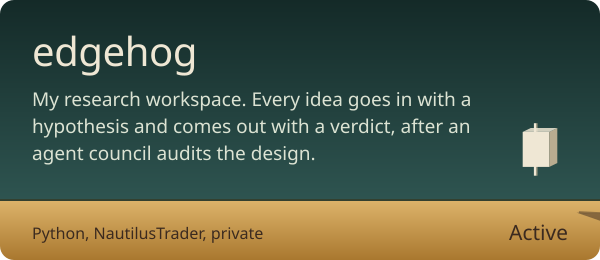
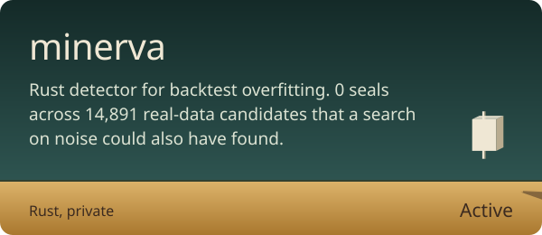
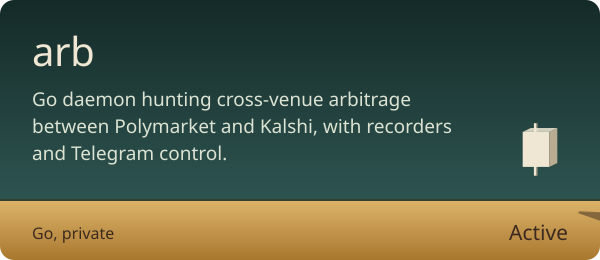
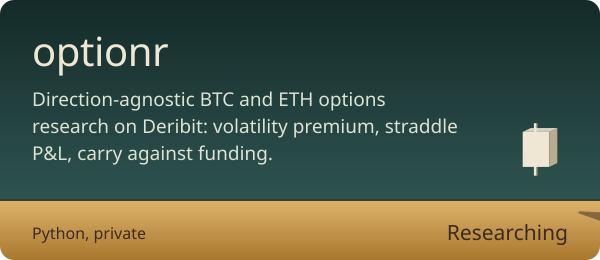
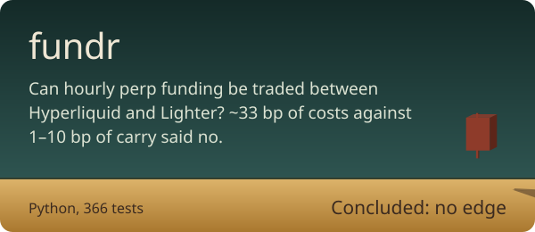
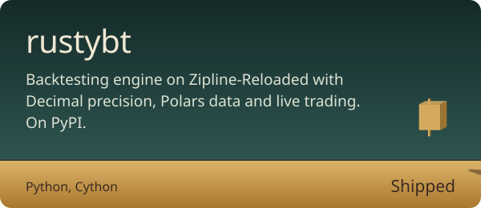
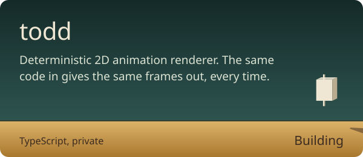
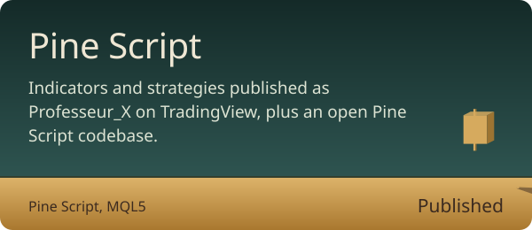
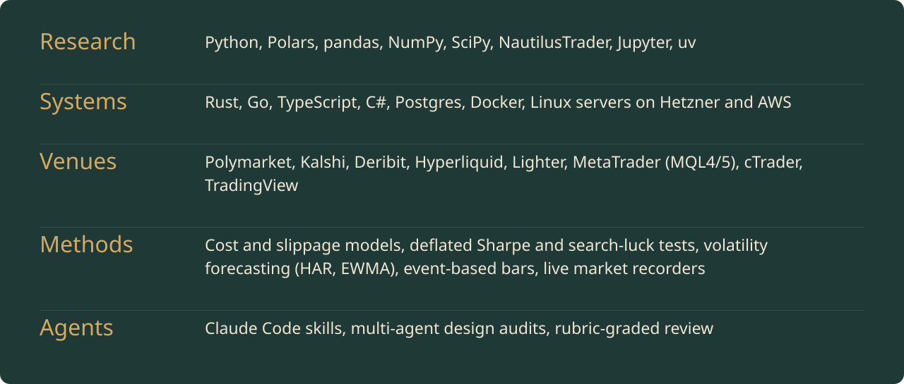

## Now

- Running **arb**, a Go daemon that watches Polymarket and Kalshi for the same event priced two ways.
- Measuring whether BTC and ETH options pay a volatility premium once costs are counted.
- Building **minerva** in Rust, to throw out backtests that a search on noise could have produced.

## The lab

Most of the current work lives in private repos. Public ones are linked.

## How I work

- **Costs before models.** fundr ended before a single model was fitted: measured round-turn costs of ~33 bp swamped 1&ndash;10 bp of carry.
- **Beat the noise.** A backtest counts only if it beats what the same search finds on shuffled data.
- **Keep the record.** Dead ideas get written up with what was tested, so they stay dead.

## Instruments

 

Find me on [TradingView](https://www.tradingview.com/u/Professeur_X/), [X](https://x.com/thejerryinyang), [LinkedIn](https://www.linkedin.com/in/jerry-inyang-047870180/) and [Instagram](https://instagram.com/thejerryinyang), or write to [notjerry@altmail.kr](mailto:notjerry@altmail.kr).
